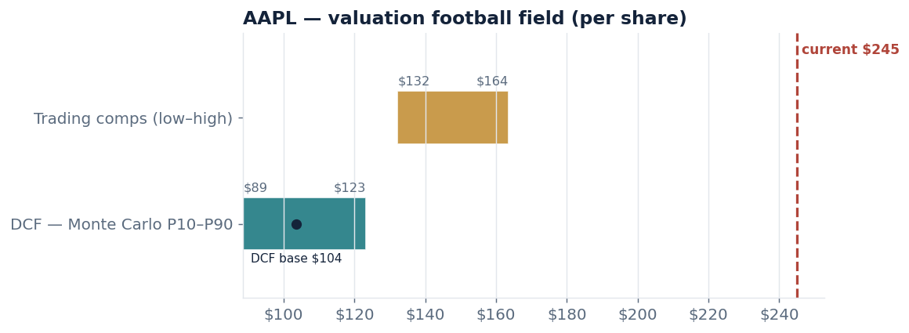
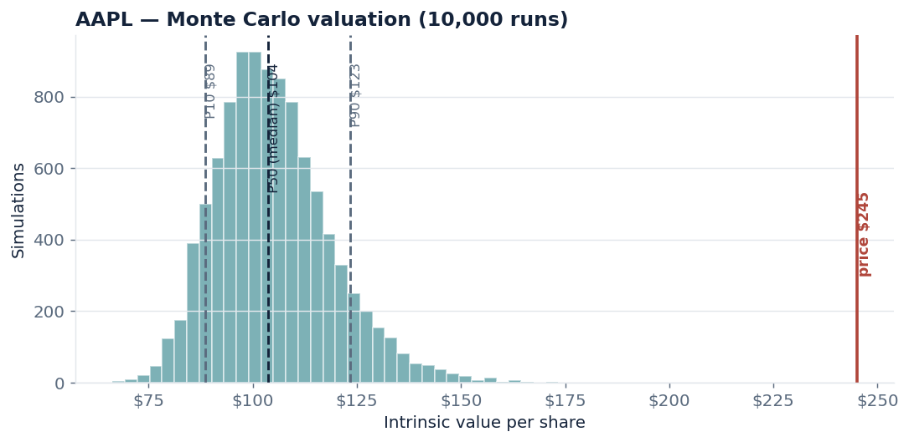
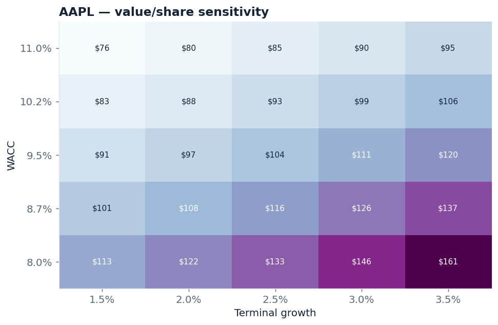
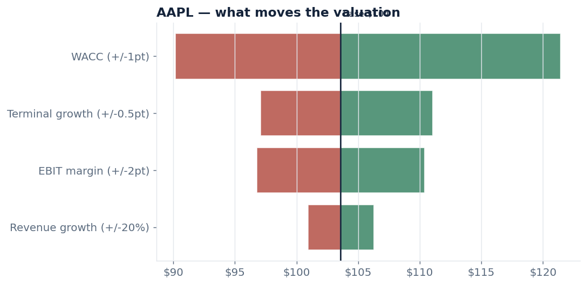

# EquityLens — automated DCF & comparables valuation

Type a ticker and get a full valuation: a discounted cash flow model built from
the company's real SEC filings, a Monte Carlo range around it, a trading-comps
cross-check, and a reverse-DCF that backs out what the market is assuming.




## What it does

Given a ticker, EquityLens:

1. Pulls the last five years of financials straight from **SEC EDGAR's XBRL API** (real 10-K numbers).
2. Builds an **unlevered DCF** — projects free cash flow off the company's own margins, capex and working-capital history, discounts at a CAPM-based WACC, and bridges enterprise value to a per-share value.
3. Wraps that in a **Monte Carlo** simulation (10,000 runs) so the output is a range, not a single fragile number.
4. Cross-checks against **trading comps** (peer EV/EBITDA, P/E, EV/Sales).
5. Runs a **reverse DCF** — the discount rate today's price implies — so you can see what the market is really betting on.

## Worked example — Apple (FY2025 filings)

| | Value / share |
|---|---|
| DCF base case | **$104** |
| DCF Monte Carlo P10–P90 | **$89 – $123** |
| Trading comps (low–high) | **$132 – $164** |
| Current price | **$245** |
| Market-implied WACC | **~5.5%** (vs. my 9.5% assumption) |

**Read:** a conservative, history-based DCF puts Apple around $100–125, and even
generous comps top out near $164 — both below the ~$245 market price. That gap is
the point, not a bug: to justify $245 the market is effectively discounting Apple
at ~5.5%, i.e. pricing in lower risk and more durable growth than five years of
history alone imply. The tool's job is to make that assumption explicit and
sizeable, then let you argue with it. (Microsoft tells a related story — its DCF
sits well below price because it's mid-way through a ~$116B/yr AI-capex cycle that
depresses near-term free cash flow. See [examples/](examples).)

## How it works

- **Fundamentals: SEC EDGAR.** `edgar_client.py` resolves the ticker to a CIK, pulls `companyfacts`, and extracts the annual lines the model needs, trying several XBRL tags per line because companies don't all tag things the same way.
- **Market inputs live in `data/assumptions.json`.** Risk-free rate, equity risk premium, beta and current price are *inputs* (dated snapshots you replace with live values), kept separate from the hard filing data on purpose — that's the line between data and analyst judgment.
- **The DCF drives off history.** EBIT margin, D&A, capex and working capital are taken as shares of revenue from the last three years; growth fades from the recent trend to the terminal rate.

## Charts

| Monte Carlo distribution | WACC × terminal-growth sensitivity |
|---|---|
|  |  |

| What moves the valuation | |
|---|---|
|  | |

## Quickstart

```bash
python3 -m venv .venv && source .venv/bin/activate
pip install -r requirements.txt

# value any ticker: pulls SEC data, writes charts + a JSON summary
python src/run_valuation.py AAPL

# export the model to Excel
python src/export_excel.py AAPL

# or run the interactive app
streamlit run app.py

# tests (no network)
python tests/test_dcf.py
```

Before hammering SEC's API, put your email in `CONTACT` at the top of
`src/edgar_client.py` — they ask every automated caller to identify itself.

## Repo structure

```
equitylens/
├─ app.py                  Streamlit UI
├─ src/
│  ├─ edgar_client.py      SEC EDGAR pull + XBRL extraction
│  ├─ dcf.py               FCF projection, WACC, DCF math
│  ├─ comps.py             peer-multiple valuation
│  ├─ simulate.py          Monte Carlo, sensitivity, reverse DCF
│  ├─ viz.py               charts
│  ├─ export_excel.py      .xlsx model
│  └─ run_valuation.py     end-to-end for one ticker
├─ data/
│  ├─ assumptions.json     market inputs (edit these)
│  └─ peers.json           peer multiples for comps
├─ examples/               sample outputs (AAPL, MSFT)
├─ tests/                  DCF unit tests
└─ assets/                 charts
```

## Honest limitations

- **Market inputs are dated snapshots.** Price and beta live in `assumptions.json`; a live feed (yfinance) is easy to wire in but isn't used here, so update them before trusting an upside number.
- **A five-year DCF undervalues high-quality compounders.** That's a known property of the method, not a defect — which is exactly why the comps and reverse-DCF layers exist.
- **Comps are a sanity band.** Peers for a company like Apple are imperfect; treat the range as a cross-check, not a target.
- Not investment advice.
